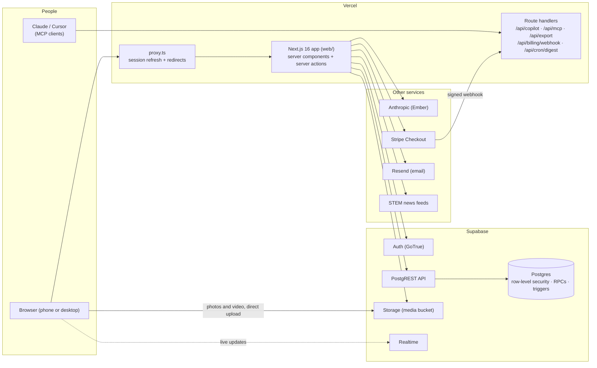

# Architecture (technical)

How Forge is built, for engineers. The plain-language version is [overview.md](overview.md). Last checked against the code on 2026-11-10.

## The system at a glance



**The rule that shapes everything: the database is the security boundary.** The app never holds an admin key for member requests. Every read and write goes through Supabase as the signed-in member, and Postgres row-level security (RLS), column grants and security-definer functions decide what's allowed. A bug in the web app can show the wrong thing; it can't let someone read or change what the database refuses.

## Tech stack

| Layer | What | Why |
|---|---|---|
| **Web app** | Next.js 16 (App Router, Cache Components / partial prerendering), React 19, TypeScript | Server components keep data reads on the server; partial prerendering makes pages fast without giving up personalization |
| **Styling and motion** | Tailwind CSS 4, `motion`, `lucide-react` icons | Design tokens on `:root` with six themes; light and dark |
| **Validation** | `zod` | Every server action parses its input before touching the database |
| **Database and auth** | Supabase: Postgres 17, Auth (GoTrue), PostgREST, Storage, Realtime | One service for accounts, data, files and live updates; RLS lets the database enforce the rules |
| **AI (Ember)** | Anthropic API (`@anthropic-ai/sdk`, model `COPILOT_MODEL`, default `claude-sonnet-5`) | Tool use with *approve-first* cards: Ember proposes, a member confirms |
| **Payments** | Stripe Checkout over its REST API, with a signed webhook | Off until keyed; challenge sponsorships fall back to free "pilot" requests |
| **Email** | Resend | The weekly digest (dry run until keyed); sign-up emails go through Supabase Auth's SMTP |
| **Hosting** | Vercel | Builds `web/` on every push to `main` |
| **iPhone** | SwiftUI (iOS 26), XcodeGen, `ForgeKit` package, same Supabase backend | In `ios/`; paused (Linear FIX-33) |
| **Tests** | Node's test runner (`tsx`), SQL rule tests, Playwright (Chrome), Lighthouse CI, OWASP ZAP, k6 | See "Quality gates" |

## Code map

```
web/src/app/            Routes (App Router)
  (app)/                Signed-in app: feed, c/[id] clubs, projects, messages, events, network,
                        talent (Find builders), challenges, admin, settings, u/[id] profiles…
  (auth)/               Log in, sign up, reset
  api/                  Route handlers: copilot (Ember), mcp (AI tools), export (your data),
                        billing/webhook (Stripe), cron/digest (weekly email)
  onboarding/ request-school/ r/[token]/ privacy/   Public and onboarding pages
web/src/lib/            Server logic: one file per domain (posts.ts, milestones.ts, challenges.ts,
                        week.ts, digest.ts, billing.ts, copilot-*.ts…)
web/src/lib/supabase/   Clients (server, browser, admin), auth-errors.ts
web/src/components/     UI by area (feed, messages, media, report, landing, ui.tsx primitives)
web/src/proxy.ts        Runs before every request: refreshes the session, optimistic redirects
web/tests/              Unit tests (npm test)
web/e2e/                End-to-end, quality and load tests on a local Supabase (Docker)
supabase/*.sql          The database, one additive file per step; order in supabase/order.txt
supabase/tests/         SQL rule tests, run as real members inside rolled-back transactions
supabase/maintenance/   health-check.sql (read-only), remove-test-data.sql
ios/                    The iPhone app (SwiftUI)
public/                 The original vanilla app, kept until production is confirmed on web/
.github/workflows/      CI, CodeQL, preview deploy, Linear sync, load test
.claude/skills/         /next, /ship, /standup for working from the Linear board
```

## How a request flows

1. **`proxy.ts`** runs first. It refreshes the Supabase session cookie and checks the session with `getClaims()` (verified locally when the project uses asymmetric JWT keys, Linear FIX-53). Signed-out visitors on app pages go to `/login`; a *temporary* auth error never counts as signed out (`lib/supabase/auth-errors.ts`).
2. **A server component** renders the page. `getViewer()` (cached per render) returns the member and profile; data comes from Supabase **as that member**, so RLS applies. Data reads sit inside `<Suspense>` (required by Cache Components).
3. **A server action** handles a write (post, verify, RSVP…): `zod` validates the form, Supabase writes as the member, the database's RLS, triggers and rate limits have the final say, and `revalidatePath` refreshes what changed.
4. **Realtime** pushes changes (new posts, messages) to open pages, which refresh themselves.
5. **Files** upload straight from the browser to the `media` Storage bucket, into the member's own folder (enforced by Storage policies), then attach to a post.

## Data and security model

- **Schema:** 42 additive SQL files, run in `supabase/order.txt` order. Production still needs the newer ones: steps 5–36 in [next-migration.md](next-migration.md) (Linear FIX-25). Tables, who can do what, and known limits: [data-model.md](data-model.md).
- **Row-level security on every table.** The health check fails loudly if one is missing.
- **Column grants:** members can insert and update only the columns meant for them. For example, a post's author, counts and timestamps are set by the database, never by the client.
- **Security-definer functions** for actions that need checks across tables: verifying a milestone, publishing a challenge, reports, blocking. Each starts by checking who's calling.
- **Verification is the core rule set** (step 17): evidence required, verifiers can't be on the team, per-officer weekly limits, an append-only `verification_events` log, revocation and disputes. Every rule has a SQL test.
- **Abuse limits** in the database: rate limits per member (step 23, tunable in `app_config`), school-email and minimum-age rules at sign-up (step 25), blocking that hides content both ways (step 32), reports resolved by Forge admins.
- **The app adapts to the database.** `lib/db-features.ts` probes which steps have run and hides features whose tables don't exist yet, so production never breaks between a deploy and a migration.
- **Secrets:** server keys live in Vercel environment variables, never in the repo. The service-role key is used only by the Stripe webhook and the digest cron (`lib/supabase/admin.ts`).
- **Headers:** a Content-Security-Policy plus HSTS, nosniff, no framing, a referrer policy and a permissions policy on every response (`next.config.ts`).

## Environments

| | Web | Database | Who it's for |
|---|---|---|---|
| **Production** | Vercel project `forge-app` (Ian's team), from `main` | Supabase project **FORGE** | Members |
| **Preview** | `forge-preview-eight.vercel.app`, deployed from `main` by `.github/workflows/preview-deploy.yml` | Production today; moving to **forge-staging** (Linear FIX-2) | Testing a build before production picks it up |
| **Local** | `npm run dev`, or the production build on `:3200` in tests | `web/e2e/local-supabase.sh`: a private Supabase in Docker, with seed data | Development and every automated test |

`web/.env.local` points at **production**: never run tests or scripts that write against it.

## Delivery: from a commit to production

1. Push to `main` (two founders; see [CONTRIBUTING.md](../CONTRIBUTING.md)).
2. GitHub Actions runs the quality gates below. A red run stops everything until it's fixed.
3. Vercel builds and deploys `main` to production. The preview workflow deploys the same commit to the preview URL.
4. Database changes ship separately: a new step file in `supabase/` runs in the Supabase SQL Editor after it lands, in `order.txt` order; the health check confirms it.
5. The Linear sync links, closes or logs the commit on the board.

## Quality gates (every push to main)

| Job | What it proves |
|---|---|
| **Typecheck, lint, unit tests, build** | Types, lint rules and 35 unit tests pass; the production build succeeds and the smoke test serves the key pages |
| **End-to-end** | A throwaway Supabase with every database step, all SQL rule tests, then 8 browser journeys (79 checks) as real members, failing on any Content-Security-Policy violation |
| **Speed, accessibility and security scan** | Lighthouse budgets on public and logged-in pages (accessibility and best practices ≥ 90, no layout shift) and an OWASP ZAP scan of the running app that fails on any High-risk finding |
| **Dependency audit and secret scan** | `npm audit` (high and critical) and gitleaks over the whole git history |
| **CodeQL** | Static security analysis (also weekly); fails on severity 7 or higher |

On demand: `npm run load` (k6: 200 members browsing at once plus a sign-up burst). Weekly: Dependabot dependency updates.

## Decisions worth knowing

- **Push to main, CI as the gate** while there are two founders. The switch to pull requests and branch protection is a checklist in CONTRIBUTING.md (Linear FIX-4).
- **No nonce-based CSP:** nonces would force every page to render per request and disable partial prerendering. The no-nonce policy blocks other sites' scripts and frames; hash-based SRI is the next step (FIX-46).
- **Additive migrations only.** A step never drops what the live app uses, so a deploy and a migration can land in either order.
- **Ember is approve-first:** it can read and propose, never write or verify without a member's tap (tested in `web/tests/ember-approve-first.test.ts`).
